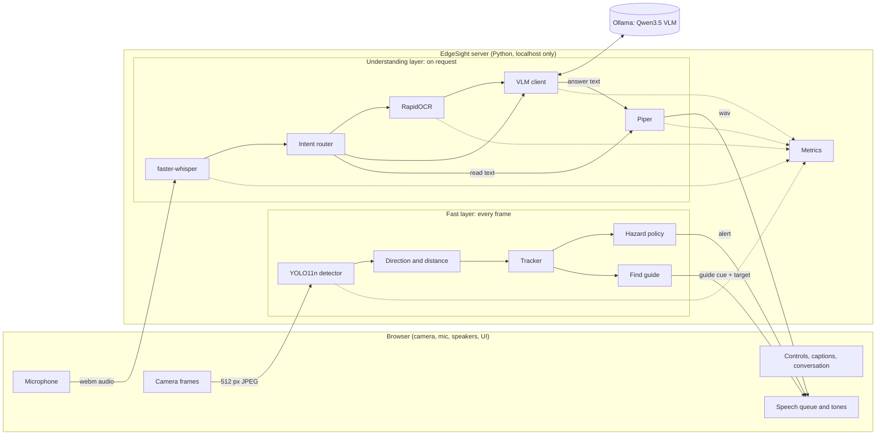
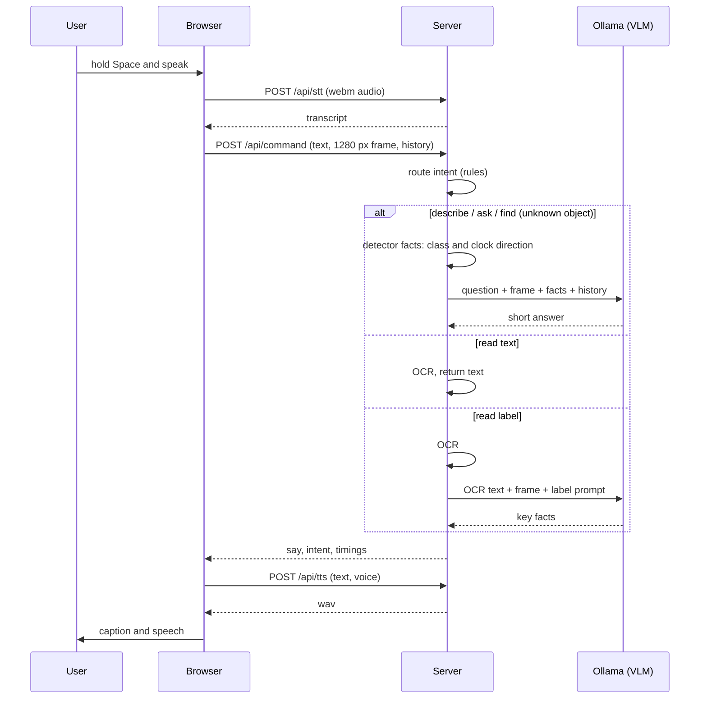

# EdgeSight: features and architecture

EdgeSight is an offline AI vision assistant for blind and low-vision people. A camera and microphone go in; spoken answers and optional alerts come out. Every model runs on the device. Nothing is sent to a cloud service.

This document describes what exists in the code today (version 0.1.0), how it fits together, what has been measured, and what is not done yet. Numbers marked *measured* come from `results/benchmark.md` on the stand-in PC. Anything that is a plan rather than a result is labelled as such.

- Competition: ASUS UGen AI League Innovation Hackathon. Theme: Everyday AI. Track: Battlefield Lightning (ASUS UGen300, Hailo-10H).
- Stage I submission deadline: Wed 14 Oct 2026, 17:00 Taiwan time.
- Product context and positioning: [PRODUCT.md](PRODUCT.md).

---

## 1. What it does

### 1.1 Talk to it

| Feature | Detail |
|---|---|
| Push-to-talk | Hold **Space** (or hold the mic button), speak, release. A ring around the mic follows the loudness of your voice. A tone marks start and stop. |
| Speech to text | faster-whisper `small.en`, int8, on CPU. Voice-activity filtering is on, greedy decoding, English only. |
| Typed input | A text box accepts the same commands, for testing and for users who prefer typing. |
| Spoken answers | Piper neural text-to-speech, on CPU. 21 voices (American and British English), chosen in Settings. |
| Captions | What you said and what it answered appear over the camera. Can be switched off. |
| Replay and repeat | Every answer has a replay button. Saying "repeat" repeats the last answer. |
| Stop | The **Stop** button or **Esc** silences speech immediately and ends find mode. |

### 1.2 Ask about the scene

| Command (examples) | What happens |
|---|---|
| "What's in front of me?", "describe the room" | The vision-language model (VLM) describes the scene in one short sentence. |
| Any other question: "What colour is his tie?", "How many people are there?" | Free-form question answering about the current frame. The last few turns are remembered, so follow-ups work. |
| "Read this", "what does the sign say" | OCR reads the visible text and speaks it as it is. |
| "Read the medicine label", "how many pills do I take" | OCR plus the VLM extract the key facts: what it is, name, dose, strength, directions, warnings, expiry date. It says so if the text is unreadable. |
| "Find my cup", "where is the chair" | Find mode (below). Words like "mug", "phone", "sofa", "bike" map to the detector's classes. |
| "Is it safe to cross?", "can I go now", "are there cars coming" | **Safety questions.** EdgeSight never certifies safety. It says "I can't tell you it's safe. Please listen for traffic and use your cane or guide dog." and then describes what it sees. |
| "Hazards on / off" | Switches hazard alerts. |
| "Help" | Lists what you can say. |

Answers are short on purpose. The default is one sentence under about 20 words, because the answer is read aloud. The model is told to give more only when asked for detail, to never name a real person, to never say it is safe to cross a road or to walk somewhere, and to say so briefly when it cannot see what was asked about.

**Safety is enforced in code, not only in the prompt.** Safety questions are routed by rule to a fixed refusal. Any answer from the model that claims safety ("it is safe to cross", "the road ahead is clear", "no cars are coming") is scrubbed: only the offending sentence is removed, and if nothing is left the refusal is spoken instead. Both behaviours are unit-tested (`tests/test_safety.py`).

Directions are given as clock positions ("at 11 o'clock"; 12 o'clock is straight ahead), the notation used in orientation-and-mobility training. **Distances are never shown or spoken.**

### 1.3 Find mode

Say "find my cup". EdgeSight locks onto that object class and guides you while you pan the camera:

- Speaks "Cup found at 11 o'clock." when it first sees the object.
- Plays stereo sonar tones: pitch rises and the tone pans left or right as the object nears the centre; ticks get faster as it gets closer; a double chirp plays when it is centred.
- Speaks "Straight ahead." when it is centred (at most every 6 seconds).
- Says "Lost the cup. Pan slowly." if it disappears for 2 seconds.
- Draws a ring on the object on the camera view.

### 1.4 Hazard alerts (off by default)

A fast, rule-based layer runs on every frame and never uses the VLM. It is **off by default** and is switched on with the Hazards switch, **H**, or by voice.

- **Danger** is spoken, for example "Person straight ahead." An object counts as danger when it is in your path (within 18° of straight ahead, or the box straddles the centre) and within about 1 m, or 4 m for vehicles; or when it is approaching and in the path.
- **Warning** is shown on screen only (the label dot turns amber). It is never spoken.
- Each object is announced once. It is announced again only if it gets worse, gets clearly closer, or 15 seconds pass.
- Alerts are stereo-panned beeps plus speech. Danger interrupts anything else being said.
- When hazards are off, nothing alerts, nothing changes colour, and answers carry no safety line.

When hazards are on, "describe" answers begin with a measured safety line ("Careful: chair on your left.") that comes from the detector, not from the model.

### 1.4a Detection overlay (off by default)

The **Detections** switch (**B**) draws a rounded box and a pill label on each object ("person · left"). A small HUD shows frames per second, detector time and object count. With hazards, detections and find mode all off, the live loop goes idle and uses no CPU.

### 1.5 Interface

- **Camera card** with state chips (Listening, Finding, Hazards on), an alert banner, and captions.
- **Control dock:** Read text, Read label, Hold to talk, Describe, Find. Hazards and Detections are switches on the left; Stop is isolated on the right.
- **Conversation panel** in a messaging style, with a tag and timing under each answer, a replay button, and a text box.
- **Details panel** (**V**): an on-device pipeline table with the speed of each stage against its target budget. Hidden by default.
- **Settings:** voice, scene model (small or large), camera, rotate 180°, mirror, tones while finding, alert tones, captions, detection boxes.
- **Offline indicator** in the header (see section 6).
- **Demo mode:** `http://localhost:8800/?demo=bus.jpg` uses a still image from `demo/` instead of the camera.
- **Preferences** persist in the browser (`localStorage`): hazards, detections, details, voice, model, toggles.

### 1.6 Accessibility

- Everything is operable from the keyboard: Space, R, L, D, F, H, B, V, Esc.
- Spoken output is mirrored into a screen-reader live region.
- Visible focus rings, switches expose `role="switch"` and `aria-pressed`, and animation stops when the system asks for reduced motion.
- Audio carries direction: alerts and find tones are stereo-panned.
- No information is carried by colour alone: chips and labels always have text.

---

## 2. Architecture overview

Two layers with a hard rule between them: **safety comes from the fast layer; understanding comes from the slow layer.** The VLM can be wrong, so it is never in the safety path.



### 2.1 Layers

| Layer | Runs | Contains | Latency target |
|---|---|---|---|
| Fast layer | Every frame, only when hazards, detections or find mode need it | Object detector, direction and distance estimate, tracker, hazard policy, find guide | tens of milliseconds |
| Understanding layer | Only when you ask | Speech to text, intent router, OCR, VLM, text to speech | about a second or two |
| Browser shell | Always | Camera and mic capture, drawing, audio output, UI | n/a |

### 2.2 Processes

- **EdgeSight server:** one Python process (`python -m edgesight`), standard-library HTTP server, bound to `127.0.0.1:8800`. It loads the detector, OCR, speech-to-text and text-to-speech models at start.
- **Ollama:** a separate local process that serves the VLM on `localhost:11434`. The server warms the small model at startup so the first question is fast.
- **Browser:** any modern browser on the same machine. Camera, microphone and audio output all live here; nothing is recorded to disk.

---

## 3. How a request flows

### 3.1 A spoken question



### 3.2 Live detection (only when needed)

1. The browser grabs a 512 px JPEG about as fast as the server returns results.
2. `POST /api/detect` returns detections (class, box, angle, clock position, level), an alert if one is due, a find cue, and the find target.
3. The browser draws the overlay, plays tones, and queues speech. If hazards, detections and find mode are all off, the loop sleeps.

### 3.3 Priority of speech

The browser keeps one speech queue. Ranking: danger alerts (they clear the queue and interrupt) > warnings > find cues > answers. Short phrases (under 90 characters) are cached as audio so repeated alerts are instant. Alerts older than 4 seconds are dropped instead of being spoken late.

---

## 4. Components

### 4.1 Backend (`src/edgesight/`)

| File | Responsibility |
|---|---|
| `server.py` | HTTP server, API routing, command handling, offline check, static files. Ignores clients that disconnect mid-request. |
| `hazard.py` | Detector wrapper, geometry, tracker, hazard classification and alert policy, find guide, scene summary. |
| `router.py` | Rule-based intent routing and spoken-word to detector-class mapping. |
| `vlm.py` | Ollama client, the system prompt, label prompt, warm-up, answer clean-up. |
| `ocr.py` | RapidOCR wrapper, confidence filter and reading-order sort. |
| `voice.py` | faster-whisper wrapper and the multi-voice Piper wrapper. |
| `metrics.py` | Rolling latency statistics and a CSV log. |
| `config.py` | Paths, model names and settings, all overridable by environment variables. |

**Detector (`hazard.Detector`).** YOLO11n exported to ONNX, run with ONNX Runtime on CPU at 416 px. Input is letterboxed, output is 80 COCO classes, confidence 0.35, non-maximum suppression with IoU 0.45.

**Geometry.** Direction comes from the box centre and the camera's horizontal field of view (default 70°, the Logitech C920). Distance is a pinhole estimate from the object's typical real-world size (about 45 classes have one). It uses only the box edges that are not cut off by the frame and takes the smaller estimate. Distance is used internally for hazard levels and find-tone rate. It is an estimate, and it is never shown or spoken.

**Tracker.** A greedy IoU tracker gives each object a stable id and a smoothed distance history. An object counts as approaching when its distance falls faster than 0.5 m/s over the last 1.5 seconds and it is within 6 m.

**Hazard policy.** See section 1.4. The rules live in `classify()` and `HazardMonitor`. Obstacle classes include person, chair, bench, couch, table, plant, hydrant, dog, suitcase, bed, toilet, refrigerator and others; vehicles use larger distances.

**Router.** Ordered regular expressions with a fixed priority: stop, help, repeat, hazards on/off, safety question, find, label, read, describe, then free-form ask. Find comes before label so "find the cough medicine" is a search, not a label read. It is rule-based on purpose: instant, predictable and unit-tested.

**VLM client.** Qwen3.5 through Ollama. A system prompt keeps replies short, forbids distances and unsafe reassurance, and tells the model to admit uncertainty. Each question also receives a line of detector facts, such as `person at 12 o'clock; chair at 1 o'clock`. Up to 8 earlier messages are sent for context. Temperature is 0.2 and replies are capped at 60 tokens (110 for label reading); a cut-off sentence is trimmed back to the last complete one.

**OCR.** RapidOCR (PaddleOCR detection and recognition models in ONNX). Lines below 0.5 confidence are dropped. Lines are grouped into rows and sorted left to right, then top to bottom.

**Speech.** faster-whisper accepts the browser's recorded audio directly. Piper voices load on first use and stay in memory.

### 4.2 Frontend (`web/`)

Plain HTML, CSS and JavaScript. No framework and no build step.

| File | Responsibility |
|---|---|
| `index.html` | Structure and the drawn icon set. |
| `style.css` | The whole look: dark theme, layout, motion. Fonts are bundled. |
| `app.js` | Camera, detection loop, overlay drawing, tones and sonar, speech queue, push-to-talk, commands, conversation, settings, status polling. |
| `fonts/` | Hanken Grotesk and Red Hat Mono, so the app works fully offline. |

---

## 5. API reference

All endpoints are on `http://localhost:8800`.

| Method | Path | Body | Returns |
|---|---|---|---|
| GET | `/api/health` | none | Model names, installed VLMs, voices, offline status, camera field of view, uptime. |
| GET | `/api/metrics` | none | Per-stage `last`, `p50`, `p95` and count. |
| POST | `/api/detect?hazards=0\|1` | JPEG | `dets[]`, `alert`, `guide`, `target`, `find`, `ms`, `frame`. Each detection has class, confidence, box, angle, clock position, level, in-path flag, approaching flag, track id. |
| POST | `/api/ocr` | JPEG | `lines[]` with text, confidence, box; joined `text`; `ms`. |
| POST | `/api/stt` | audio (webm) | `text`, `audio_seconds`, `ms`. |
| POST | `/api/tts` | JSON `{text, voice}` | WAV audio. |
| POST | `/api/command` | JSON `{text, image (base64 JPEG), model, history, hazards}` | `intent`, `heard`, `say`, plus `find`, `hazards`, `ocr`, `facts`, `safety`, `ocr_ms`, `vlm_ms`, `total_ms`, `source` where relevant. |
| GET | `/`, `/demo/<file>` | none | The web app and the sample images. |

---

## 6. Offline and privacy

- All AI runs locally: the detector, OCR, speech-to-text and text-to-speech in the server process, the VLM in local Ollama.
- The server listens on `127.0.0.1` only. Fonts and scripts are bundled. The page makes no requests to any other host.
- Camera frames and audio stay in memory and are not saved. Only timing numbers are logged (`results/latency.csv`).
- The header chip shows "Offline" or "Online, not used". It is computed by a short TCP connection test to a public DNS address from the server, cached for 15 seconds. That test exists only to show the status and sends no user data. For the video you can turn Wi-Fi off and watch the chip change.

---

## 7. Models

| Job | Model | Runtime and device | File size |
|---|---|---|---|
| Object detection | YOLO11n, ONNX, 416 px (a 640 px export is also included) | ONNX Runtime, CPU | 10.6 MB |
| Text reading | RapidOCR, PP-OCRv4 detection, classification and recognition (reads Chinese and English) | ONNX Runtime, CPU | about 16 MB |
| Speech to text | faster-whisper `small.en`, int8 | CTranslate2, CPU | about 480 MB |
| Text to speech | Piper voices, 21 included | ONNX Runtime, CPU | 63 to 114 MB each |
| Scene understanding (small) | Qwen3.5 2B | Ollama, GPU | about 2.7 GB |
| Scene understanding (large) | Qwen3.5 9B | Ollama, GPU | about 6 GB |

Licences to check before making commercial claims in the deck: Ultralytics YOLO is released under AGPL-3.0; the current `piper-tts` package is GPL-3.0 and each Piper voice has its own dataset licence; check the Qwen3.5 model card terms. Whisper, faster-whisper and RapidOCR are permissive. This is a reminder, not legal advice.

---

## 8. Measured performance

Stand-in PC: Intel Core i7-7700, NVIDIA GeForce RTX 2080 Ti (used only by Ollama), Linux. Median (p50) and 95th percentile, from `results/benchmark.md` (re-run 13 Oct 2026), 20 runs:

| Stage | p50 | p95 |
|---|---:|---:|
| Fast layer: detector 416 px + geometry + tracker + alerts | 16 ms | 17 ms |
| Fast layer at 640 px | 41 ms | 50 ms |
| OCR on a dense medicine-box photo (1280 px wide) | 1.07 s | 1.12 s |
| Text to speech, one sentence | 106 ms | 125 ms |
| Speech to text, about 4 s of audio | 1.54 s | 1.72 s |
| VLM answer, Qwen3.5 2B (1280 px frame, short answer) | 0.73 s | 1.09 s |
| VLM answer, Qwen3.5 9B | 1.44 s | 1.81 s |

Notes: frames are 1280 px wide, as the app sends them. These are CPU and GPU numbers on a desktop, not UGen300 numbers.

Run it yourself: `PYTHONPATH=src .venv/bin/python scripts/benchmark.py`. Live timings are also in the Details panel and `results/latency.csv`.

---

## 9. Design decisions

1. **Hazards never come from the VLM.** A small VLM can hallucinate. Safety comes from a deterministic detector with rules you can read and test.
2. **Quiet by default.** Hazard alerts and the detection overlay are opt-in, because constant alerts make an assistant unusable. Only danger is spoken.
3. **No distances in speech or on screen.** Distance is an estimate, so it is used internally and not presented as fact.
4. **Short answers.** Everything is read aloud, so answers default to one sentence.
5. **Rule-based routing.** A fixed intent router is faster and easier to verify than asking a model to pick a tool.
6. **Browser for capture.** The camera, microphone, speakers and UI come from the browser. It works with a phone as camera in the future and avoids native drivers.
7. **Small, replaceable parts.** Every model sits behind a small wrapper, so a stage can be swapped for a Hailo-compiled version without touching the rest.

---

## 10. Testing

- 45 automated tests (`pytest`): intent routing and spoken-word mapping (`tests/test_router.py`), distance estimation, hazard levels, alert policy and find guide (`tests/test_hazard.py`), safety refusal, safety-claim scrubbing, find-versus-label routing and answer-length limits (`tests/test_safety.py`).
- Run: `.venv/bin/python -m pytest -q tests`
- End-to-end checks done by hand with sample images: detection, describe, ask, read, read label, find, stop.
- **Not yet tested:** a live run with a real webcam and microphone in the final interface, user testing with blind or low-vision people, and any run on the UGen300.

---

## 11. Repository layout

```
edgesight/
  README / this file    FEATURES_AND_ARCHITECTURE.md, PRODUCT.md
  run.sh                start (restarts if already running)
  src/edgesight/        server, hazard, router, vlm, ocr, voice, metrics, config
  web/                  index.html, style.css, app.js, fonts/
  models/               yolo11n-416.onnx, yolo11n-640.onnx, voices/
  scripts/benchmark.py  per-module benchmark, writes results/benchmark.md
  tests/                pytest tests
  results/              benchmark.md, latency.csv
  demo/                 five licensed sample photos for demo mode and mockups (road crossing, pharmacy shelf,
                        medicine box, room, stairs), with CREDITS.md
  mockups/              product mockups (PNG) and their sources; rebuilt by scripts/mockup_screens.py + build_mockups.py
```

---

## 12. Setup and run

Requirements: Linux or macOS, Python 3.12, [uv](https://github.com/astral-sh/uv), [Ollama](https://ollama.com), a webcam and microphone.

```bash
uv venv .venv
uv pip install --python .venv/bin/python faster-whisper piper-tts "av<17" \
    rapidocr-onnxruntime opencv-python-headless numpy pillow pytest
ollama pull qwen3.5:2b
ollama pull qwen3.5:9b                      # optional, for the large model
.venv/bin/python -m piper.download_voices en_US-lessac-medium --download-dir models/voices
./run.sh                                    # opens http://localhost:8800
```

The YOLO11n ONNX files are produced once with Ultralytics (`yolo export model=yolo11n.pt format=onnx imgsz=416 simplify=True opset=17`) and saved as `models/yolo11n-416.onnx`.

Configuration (environment variables): `EDGESIGHT_PORT`, `EDGESIGHT_HOST`, `EDGESIGHT_VLM_EDGE`, `EDGESIGHT_VLM_QUALITY`, `EDGESIGHT_DET_SIZE`, `EDGESIGHT_HFOV`, `EDGESIGHT_STT`, `EDGESIGHT_VOICE`, `EDGESIGHT_THREADS`, `OLLAMA_HOST`.

---

## 13. Keyboard shortcuts

| Key | Action |
|---|---|
| Hold Space | Talk |
| R | Read text |
| L | Read label |
| D | Describe |
| F | Find an object |
| H | Hazards on or off |
| B | Detection boxes on or off |
| V | Details panel |
| Esc | Stop speech and find mode |

---

## 14. Path to the ASUS UGen300 (plan, not done)

The UGen300 carries a Hailo-10H accelerator (up to 40 TOPS INT4, 8 GB of dedicated memory) and needs a host computer, so the server keeps running on the host and the models move onto the accelerator. Which models run on the Hailo-10H must be confirmed against Hailo's model zoo and the competition's Computing Platform page before anything is promised.

| Block | Today | Stage II plan |
|---|---|---|
| Object detection | YOLO11n ONNX on CPU | Compile the same ONNX graph for Hailo and benchmark. Confirm support first. |
| Scene understanding | Qwen3.5 2B through Ollama on GPU | Evaluate a VLM that fits the 8 GB budget. The 2B model file is 2.7 GB, so memory is plausible; compatibility is unconfirmed. |
| Speech to text, text to speech, OCR | CPU | Stay on the host CPU unless Hailo versions are available and worth it. |

Stage II deliverables: latency, power and accuracy numbers on the real device, shown running in the final video.

---

## 15. Known limits and what is not done

- **No user testing** with blind or low-vision people yet. The roadmap includes partnering with an association for the blind.
- **Distance is an estimate** from typical object sizes. It is wrong for unusual sizes and for partly visible objects, which is why it is never shown.
- **The detector knows only 80 everyday classes** (COCO). It cannot detect stairs, curbs, drop-offs, or glass doors. Those need a depth sensor or a different model.
- **VLMs can be wrong.** The 2B model sometimes misreads small details. The system prompt asks it to admit uncertainty, but it cannot guarantee that.
- **A complement, not a replacement,** for a white cane or guide dog. EdgeSight must never be presented as guaranteeing safe navigation.
- **English only** for speech in and out.
- **Speech-to-text takes about 1.5 s** for a short utterance on this CPU.
- **Camera orientation:** the demo webcam is mounted upside down, so "Rotate 180°" defaults to on. Change it in Settings for other cameras.
- **Not built:** physical buttons on the pendant or strap for one-press read text, describe, read label, find and stop (planned; the software already exposes each as a single action), wearable hardware, phone-as-camera, depth sensing (roadmap), multilingual packs (roadmap), a live Hailo port.
