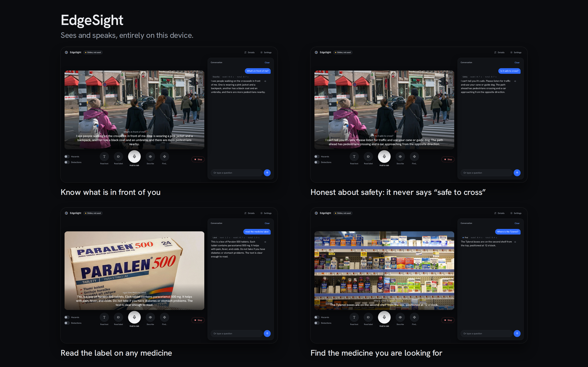
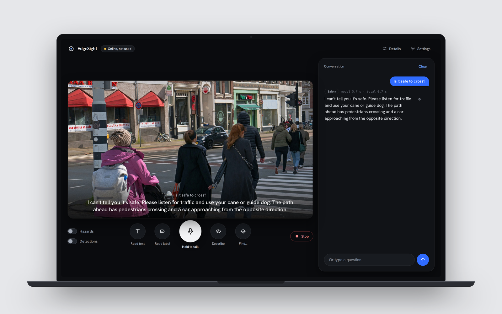
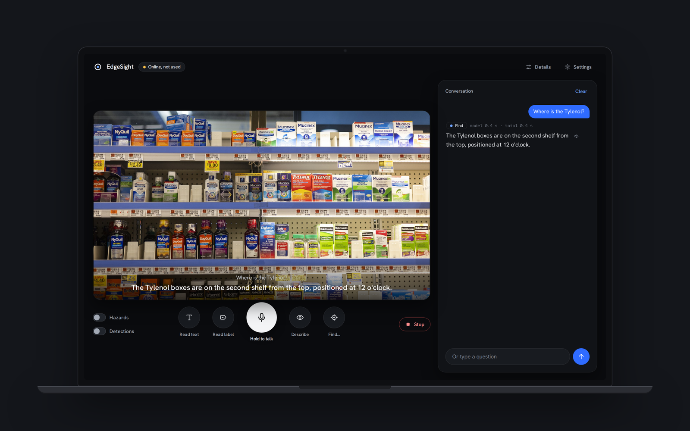
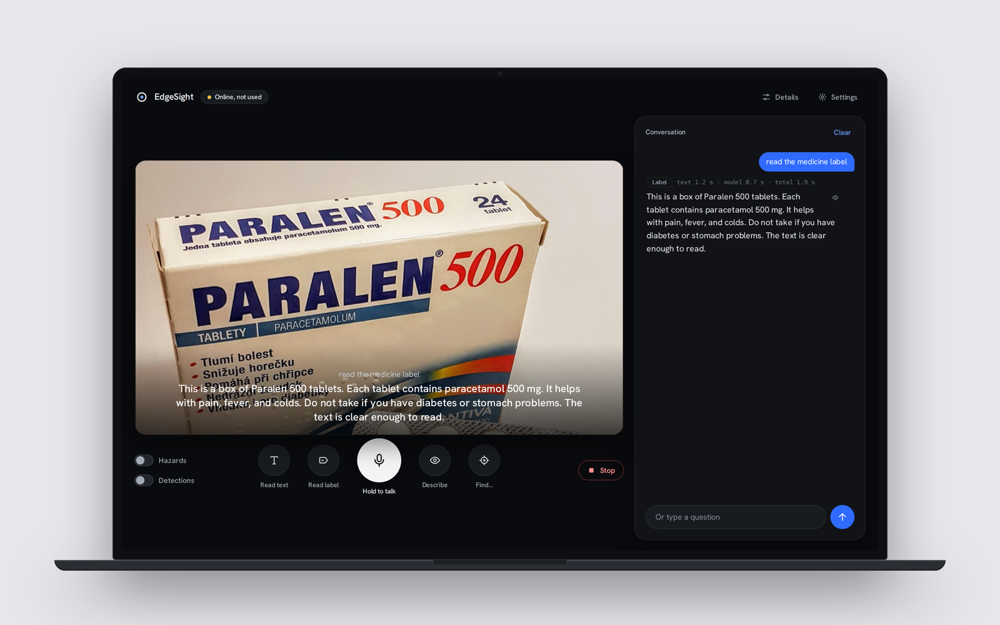
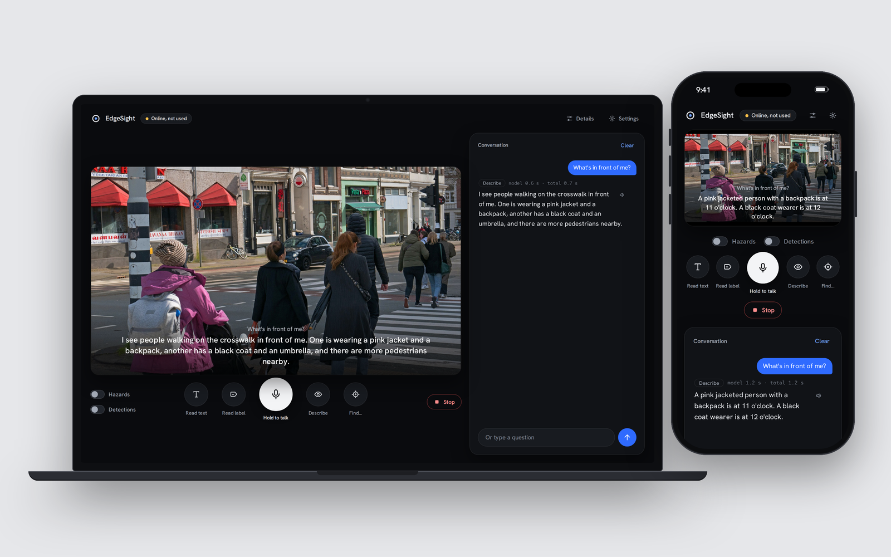
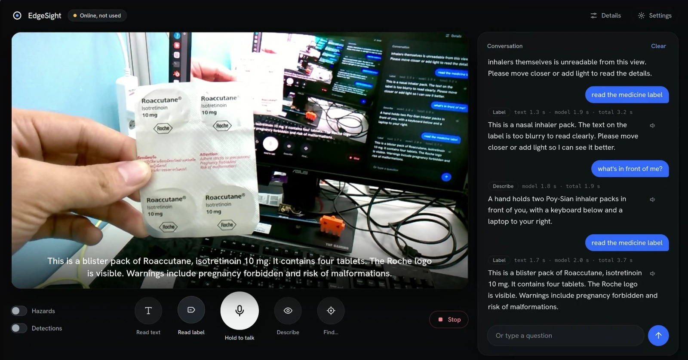
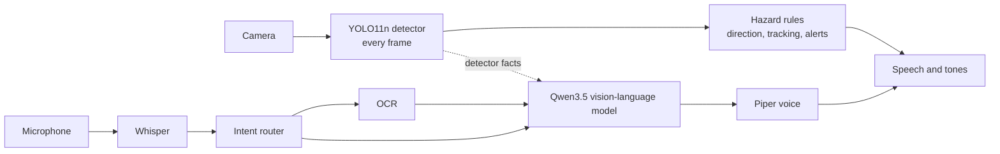
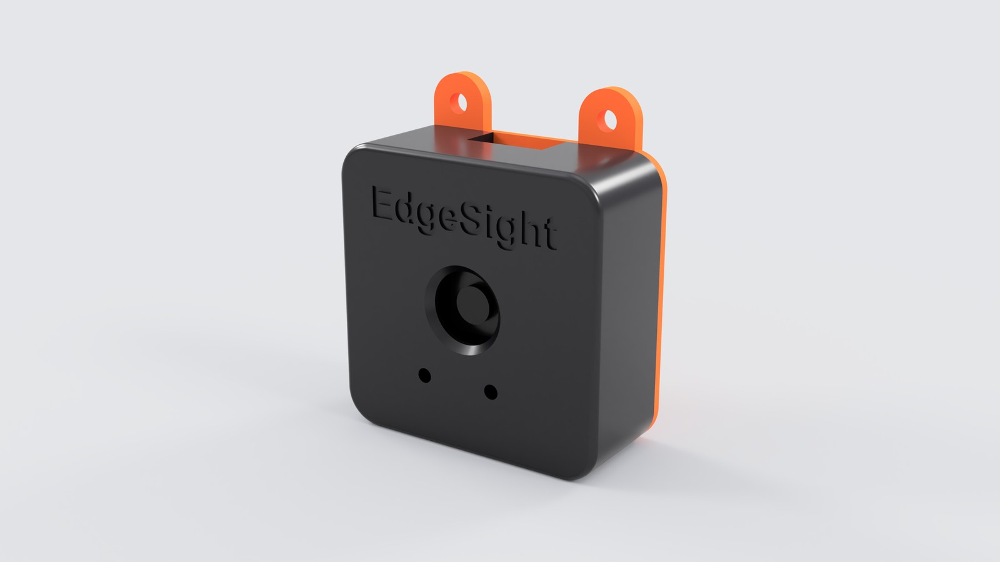
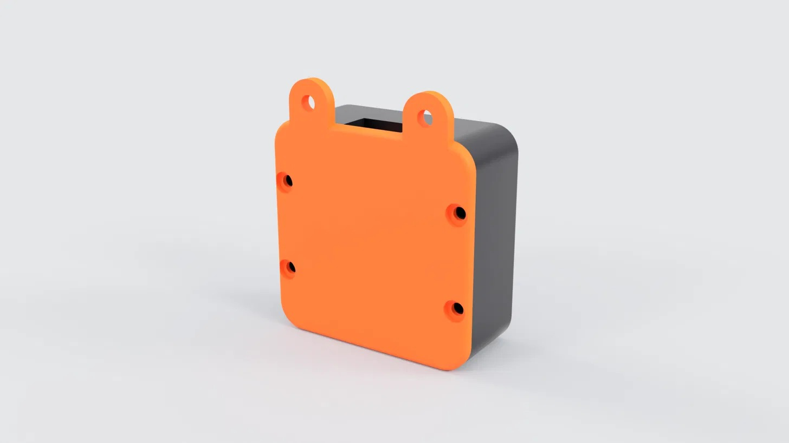

<p align="center">
  <picture>
    <source media="(prefers-color-scheme: dark)" srcset="brand/edgesight-logo.png">
    
  </picture>
</p>

<p align="center"><b>An offline AI assistant that tells blind and low-vision people what is around them, reads labels, and finds things, with every model running on the device.</b></p>

<p align="center">
  
</p>

Built for the **ASUS UGen AI League Innovation Hackathon** (theme: Everyday AI, track: Battlefield Lightning, ASUS UGen300 with a Hailo-10H). Stage I is a working prototype on a stand-in PC. The UGen300 port is the Stage II plan.

---

## Why it runs on the device

| | Cloud assistants | EdgeSight |
|---|---|---|
| **Privacy** | The camera sees homes, faces, documents and medicine labels, and uploads them | Nothing leaves the device |
| **Latency** | Needs a round trip | Hazard checks take about 16 ms per frame |
| **Offline** | Fails without signal | Works with no network at all |
| **Cost** | Subscriptions and per-call fees | None; no ongoing cost |

## What it does

Hold **Space**, ask, and it answers in text and out loud.

| You say | EdgeSight does |
|---|---|
| "What's in front of me?" | Describes the scene in one short sentence, with clock positions ("at 11 o'clock") |
| "Read the medicine label" | OCR plus a small vision-language model pull out the name, dose, directions and expiry |
| "Where is the Tylenol?" | Locates a product on a shelf |
| "Find my cup" | Guides you with speech and stereo tones until the object is centred |
| "Is it safe to cross?" | **Declines to say yes.** It says it can't tell, reminds you to listen for traffic and use your cane or guide dog, then describes what it sees |
| "Hazards on" | Spoken alerts for close obstacles (off by default, so it never nags) |

<table>
<tr>
<td width="50%"><br><sub>It never certifies safety, and still describes what is there.</sub></td>
<td width="50%"><br><sub>Finding a medicine on a pharmacy shelf.</sub></td>
</tr>
<tr>
<td><br><sub>Reading a medicine box aloud.</sub></td>
<td><br><sub>The same app on a laptop and a phone.</sub></td>
</tr>
</table>

### Real demo on a webcam

<p align="center">
  
</p>

A real screenshot (not a mockup) from the prototype running on a webcam, reading a medicine blister pack. The conversation shows what actually happened: the first read said the label was too blurry and asked the user to move closer, and after moving closer the second read got the drug, dose, tablet count and warnings right. A small model still makes mistakes, which is why it is built to say when it is unsure instead of guessing.

Screens are the real interface running on the sample photos in `demo/`, with real answers from the local pipeline. See [demo/CREDITS.md](demo/CREDITS.md) for the photo licences.

## How it works

Two layers with a hard rule between them: **safety comes from the fast layer, never from the language model.**



- **Fast layer:** YOLO11n object detection, direction and size-based distance estimates, tracking, hazard alerts. Deterministic and unit-tested.
- **Understanding layer:** speech to text, rule-based intent routing, OCR, a small VLM and text to speech, only when you ask.
- **Safety in code, not just prompts:** safety questions get a fixed refusal, and any model answer that claims safety is scrubbed. Tested in [tests/test_safety.py](tests/test_safety.py).

Full details: **[FEATURES_AND_ARCHITECTURE.md](FEATURES_AND_ARCHITECTURE.md)** (every feature, modules, API, models, limits).

## The hardware

A **two-box wearable**: a 3D-printed **pendant** on the chest carries the camera and microphones; a **compute pouch** at the waist carries a host computer, the **ASUS UGen300** and a power bank. One USB cable runs up the neck cord. Bone-conduction headphones keep the ears free.

<table>
<tr>
<td width="50%"></td>
<td width="50%"></td>
</tr>
</table>

Print files are in [docs/hardware/cad](docs/hardware/cad) (front shell, back cover, plate; STL and 3MF). The full integration plan, bill of materials, power budget and test targets are in [docs/HARDWARE_INTEGRATION.md](docs/HARDWARE_INTEGRATION.md).

## Measured performance

Stand-in PC: Intel Core i7-7700 (CPU), NVIDIA RTX 2080 Ti (used only by the VLM). Median of 20 runs, 1280 px frames. Reproduce with `scripts/benchmark.py`; full table in [results/benchmark.md](results/benchmark.md).

| Stage | Runs on | p50 |
|---|---|---:|
| Fast layer (detect, distance, track, alerts) | CPU | **16 ms** |
| Text to speech, one sentence | CPU | 106 ms |
| OCR on a dense medicine box | CPU | 1.07 s |
| Speech to text, about 4 s of audio | CPU | 1.54 s |
| Scene answer, Qwen3.5 2B | GPU | 0.73 s |
| Scene answer, Qwen3.5 9B | GPU | 1.44 s |

These are desktop numbers, **not UGen300 numbers yet**. Stage II measures the same pipeline on the accelerator.

## Run it

Requirements: Linux, Python 3.12, [uv](https://github.com/astral-sh/uv), [Ollama](https://ollama.com), a webcam and microphone.

```bash
git clone <this repository> edgesight && cd edgesight
./scripts/setup_models.sh     # environment, YOLO11n ONNX export, a Piper voice, qwen3.5:2b
./run.sh                      # opens http://localhost:8800
```

Try it with no camera: `http://localhost:8800/?demo=street.jpg` (also `label.jpg`, `pharmacy.jpg`, `room.jpg`, `stairs.jpg`).

Shortcuts: **Space** talk, **R** read, **L** label, **D** describe, **F** find, **H** hazards, **B** detections, **V** details, **Esc** stop.

Tests: `.venv/bin/python -m pytest -q tests` (45 tests).

## Models and licences

| Job | Model | Licence |
|---|---|---|
| Scene understanding | Qwen3.5 2B / 9B via Ollama | Apache-2.0 (from the model's own licence file) |
| Object detection | YOLO11n (Ultralytics), exported to ONNX | AGPL-3.0, **check before commercial use** |
| Text reading | RapidOCR (PP-OCRv4) | Apache-2.0 |
| Speech to text | faster-whisper `small.en` | MIT |
| Text to speech | Piper (`piper-tts`) and voices | GPL-3.0 package; each voice has its own licence, **check before commercial use** |

Fonts (Hanken Grotesk, Red Hat Mono) are SIL OFL. Model files are not stored in this repository; `scripts/setup_models.sh` fetches or builds them.

## Honest limits

- A **complement to a white cane or guide dog**, never a replacement. It does not guarantee safe navigation.
- **No user testing yet** with blind or low-vision people. First roadmap item.
- Distance is **estimated** from typical object sizes and is never shown or spoken. The detector knows 80 everyday classes, so no stairs, curbs or glass doors yet.
- Small vision-language models can be wrong. The device says when it is unsure and never claims safety.
- English only. Runs on a desktop today; the UGen300 port is not done.

## Roadmap

1. **Stage II:** compile the detector for the Hailo-10H, evaluate a VLM that fits the 8 GB budget, measure latency, power and accuracy on the UGen300.
2. **Physical buttons on the pendant or strap** for one-press **Read text** (text to speech), **Describe what is in front of me**, Read label, Find and Stop, so the user never needs voice or a screen, even in a noisy street. Each is already a single action in the software today (the on-screen buttons and keyboard shortcuts), so a hardware button only has to trigger the same call.
3. Depth sensing for real distance and stair detection.
4. Local-language packs for regions the big apps serve poorly.
5. User testing with an association for the blind.

## Credits and licence

Sample photos: Wikimedia Commons, see [demo/CREDITS.md](demo/CREDITS.md). Competition: ASUS UGen AI League (ASUS, Intel, Hailo).

Licence: EdgeSight's own code is released under the **[Apache License 2.0](LICENSE)**. It depends on third-party libraries and models that keep their own licences, listed in the table above; check them before commercial use.
