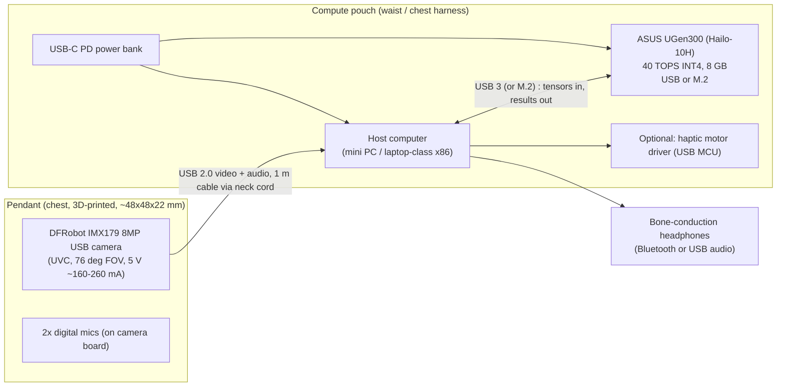

# EdgeSight: hardware integration plan (Lightning track, ASUS UGen300)

Track: **Battlefield Lightning** = ASUS UGen300 AI accelerator (Hailo-10H, up to 40 TOPS INT4, 8 GB dedicated memory, supplied as **M.2 or USB**).
Finals rule: the demo video must show the **UGen300 actually running**. So the UGen300 is the AI engine of the product, not a prop.

> Facts below marked **(verify)** are not confirmed from official sources. Check them against ASUS/Hailo documentation or the organizers before the Stage II build.

---

## 1. The one-paragraph plan

EdgeSight is a **two-box wearable**. A **pendant** on the chest carries only the camera and microphones. A **compute pouch** at the waist (or in a chest-harness pocket) carries a small host computer, the **UGen300**, and a power bank. A single USB cable runs from the pendant up the neck cord and down to the pouch. All AI (hazard detection, text reading, scene description and question answering) runs on the **UGen300**. The host only does the glue work: capturing frames, audio, speech and decision logic. Audio goes back to the user through bone-conduction headphones so their ears stay free. Nothing leaves the device.

## 2. System architecture

Data flow, in order:

1. **Capture:** the camera streams 720p or 1080p frames over UVC. The microphones come in as a USB audio device.
2. **Pre-process (host CPU):** resize, normalise, queue frames.
3. **Inference (UGen300):**
   - *always on:* object / obstacle detector (YOLO-class) for hazard alerts;
   - *always on or on demand:* OCR for signs, labels and menus;
   - *on demand:* small vision-language model (VLM) for "describe the scene" and "where is my cup?";
   - *optional:* speech-to-text for voice commands, if a suitable model runs on the Hailo-10H **(verify)**.
4. **Decision logic (host CPU):** priority rules, so a hazard always pre-empts a description. Distance estimate from box size / monocular depth.
5. **Output:** text-to-speech (offline, e.g. Piper) to the headphones, plus an optional vibration cue.

## 3. Why this host choice (and the Raspberry Pi question)

| Option | What it is | Verdict |
|---|---|---|
| **A. x86 mini PC or laptop + USB UGen300** | Simplest path. Standard drivers, plenty of CPU for audio/TTS. | **Recommended.** Use this for Stage I proof and Stage II. |
| **B. Mini PC with an M.2 slot + M.2 UGen300** | Cleaner and more compact, no external dongle. | Good if the organizers ship the M.2 version. Needs a free M.2 M-key slot. |
| **C. Raspberry Pi 5 + UGen300** | Smaller and lighter, but the compatibility of a Hailo-10H module on Pi 5 (and of the USB version on ARM Linux) must be confirmed **(verify)**. | Only if ASUS/Hailo documentation confirms it. It is a stretch goal, not the plan. |

Rule: **do not commit the demo to the Pi.** The finals video must show UGen300 working, so choose the host that is guaranteed to work.

## 4. Bill of materials

| Item | Role | Have it? |
|---|---|---|
| DFRobot IMX179 8MP USB camera (FIT0729) | Vision + mics | Yes |
| ASUS UGen300 (USB or M.2) | AI accelerator | Shipped to finalists (version announced by organizers) |
| Host: x86 mini PC or laptop | Capture, audio, TTS, logic | A laptop works for the demo |
| USB-C PD power bank (about 20,000 mAh class) | Portable power | Buy / borrow |
| Bone-conduction headphones (or earbuds) | Audio out, ears stay free | Optional for demo |
| Small waist pouch or chest-harness pocket | Holds host + UGen300 + power bank | Buy / improvise |
| 3D-printed pendant (front shell + back cover) | Camera housing | Printed |
| Short USB extension / right-angle adapters | Cable routing | As needed |
| Optional: USB MCU + vibration motor | Haptic cue | Nice to have |
| Optional: IMU or depth camera | Tilt compensation / precise distance | Phase 2 |

## 5. Mechanical and cable integration

- **Pendant:** 38 x 38 mm camera board clamped between posts; lens window, two mic holes, engraved name; cable exits the **top** between two lanyard lugs; **M2.5 x 6 mm** screws close the back cover.
- **Cable path:** pendant top, up beside the neck cord (bundle with a fabric sleeve or small clips), around the neck, **down inside clothing or under a strap to the pouch**. Keep a loop of slack at the pendant so tugs do not load the connector.
- **Pouch layout:** host, UGen300 and power bank in separate compartments so heat does not stack. Leave one side open or vented for airflow. The USB UGen300 has a metal enclosure that acts as a heatsink.
- **Hang angle:** the lanyard lugs sit on the **back (orange) cover** so the pendant rests flat on the chest and the camera looks forward instead of tilting up.

## 6. Power budget (measure, do not assume)

| Block | Estimate | Source |
|---|---|---|
| Camera | 5 V, about 160-260 mA (about 0.8-1.3 W) | DFRobot spec |
| UGen300 | a few watts under load | **(verify)**, measure with an inline USB power meter |
| Host | depends on the mini PC / laptop | measure |

Record real numbers with a USB power meter. A **watts-per-answer** figure is a strong edge-AI selling point.

## 7. Software pipeline and model allocation

| Task | Runs on | Notes |
|---|---|---|
| Frame capture, resize | Host CPU | V4L2 / OpenCV / GStreamer |
| Hazard detection (obstacles, people, stairs, doors) | **UGen300** | small YOLO-class model from the Hailo Model Zoo **(verify exact model)** |
| OCR (signs, labels, menus) | **UGen300** if a model is available, else host CPU | **(verify)** |
| Scene description / Q&A (VLM) | **UGen300** (GenAI path) | pick the smallest VLM that Hailo supports **(verify in Hailo Model Zoo GenAI list)** |
| Speech-to-text, text-to-speech | Host CPU (or UGen300 for STT if supported) | offline models |
| Priority arbiter | Host CPU | hazard alert always interrupts descriptions |

The **8 GB** on the UGen300 is shared by all loaded models, so plan to keep the detector resident and load the VLM on demand.

## 8. Targets and how to prove them (feeds the "performance validation" the finals require)

| Metric | Target | How to measure |
|---|---|---|
| Hazard alert latency (frame in to first audio cue) | about 200 ms or less | timestamp at capture, timestamp at audio start |
| Detector throughput | 15-30 FPS | per-frame timer on the host |
| Scene description latency | about 3 s or less to first spoken word | stopwatch + logs |
| Power draw, whole wearable | record watts | inline USB power meter |
| UGen300 utilisation / temperature | record | Hailo tooling **(verify command)** |
| Offline proof | works with Wi-Fi off | show airplane mode on camera |
| Accuracy | simple table on about 30 test scenes | hand-labelled clips |

## 9. "Ultimate hardware integration" tiers

- **Tier 1, must have (Stage II minimum):** camera to host to **UGen300** to audio, all running live, with the UGen300 visibly connected on camera.
- **Tier 2, should have:** push-to-talk button or voice wake word, haptic vibration for hazards (USB MCU + motor in the strap), inline power meter shown in the demo.
- **Tier 3, nice to have:** IMU in the pendant to compensate for tilt, or a small depth camera for precise distance and stairs (roadmap item for Stage I).

## 10. Risks and checks

1. **UGen300 version unknown** until finalists are announced (26 Oct). Design the host so either the USB or the M.2 version works.
2. **Driver / OS support** for the USB version: confirm with the ASUS tech webinar material or organizers.
3. **Model availability:** confirm that the detector, OCR and VLM you want exist for the Hailo-10H before promising them in the deck.
4. **USB bandwidth and power:** use short, good-quality cables; a powered hub if the host cannot supply enough current.
5. **Heat:** keep the UGen300 out of a sealed pocket.
6. **Safety framing:** a complement to a white cane or guide dog, never a replacement.

## 11. What to show where

| Stage | What you can show |
|---|---|
| **Stage I (due 14 Oct)** | This architecture diagram, the pendant renders, a laptop proof of concept, and a clear "moves to UGen300 in Stage II" slide. No UGen300 is required yet. |
| **Stage II finals video** | The real UGen300 plugged in and running, the pendant on a person, Wi-Fi off, latency overlay, power meter in frame. |
